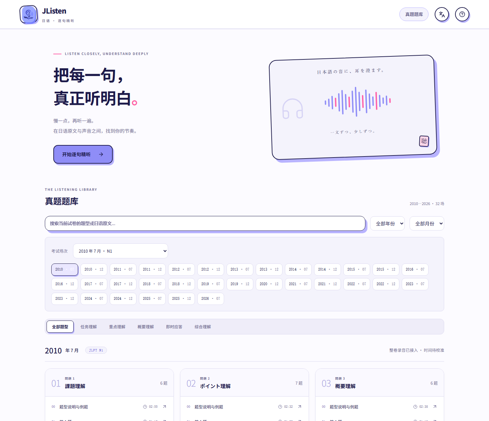
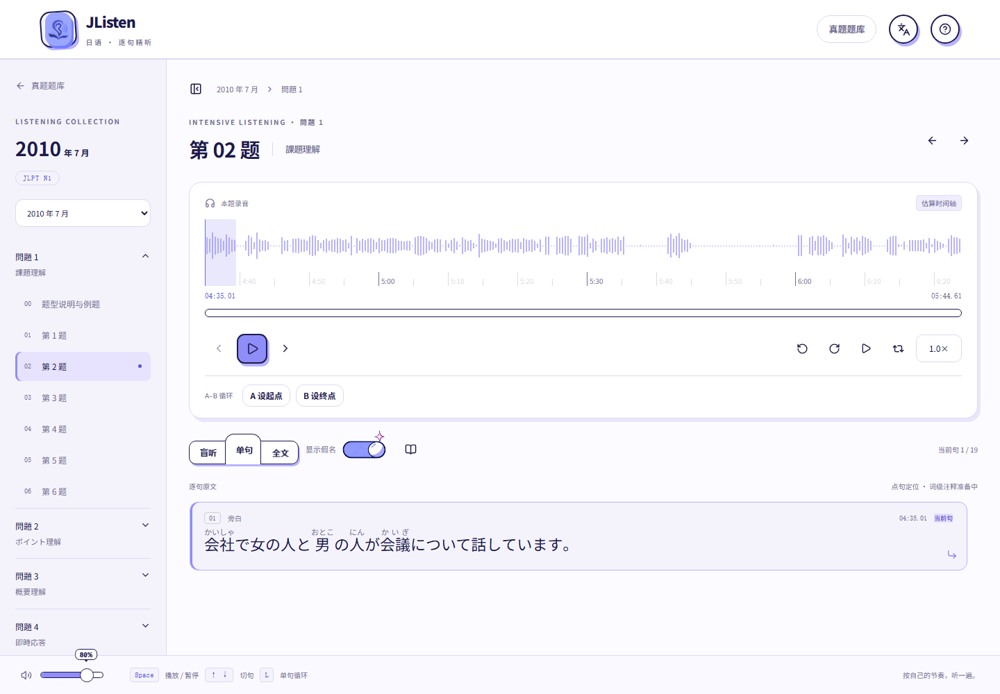
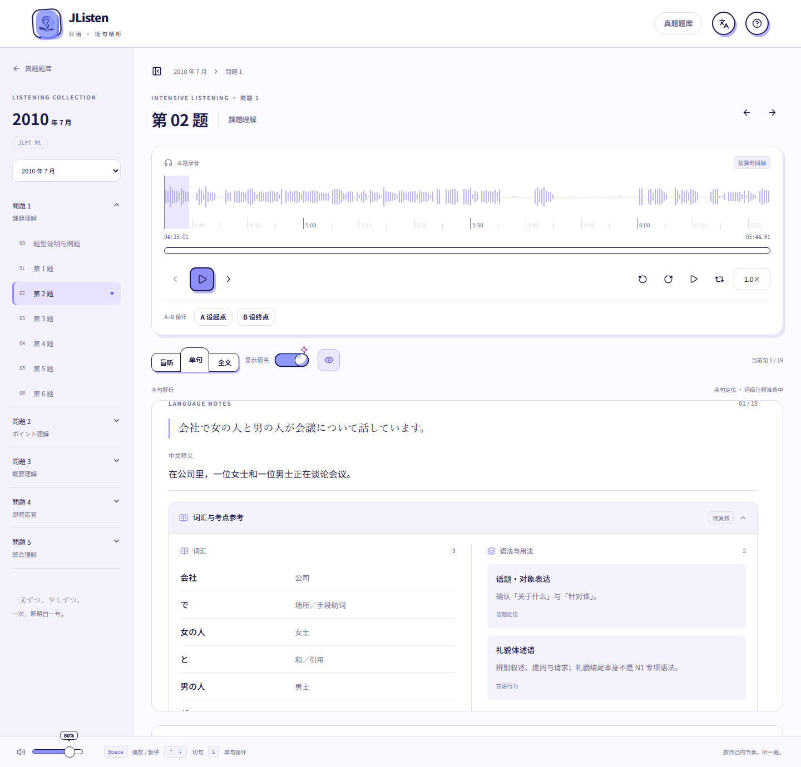
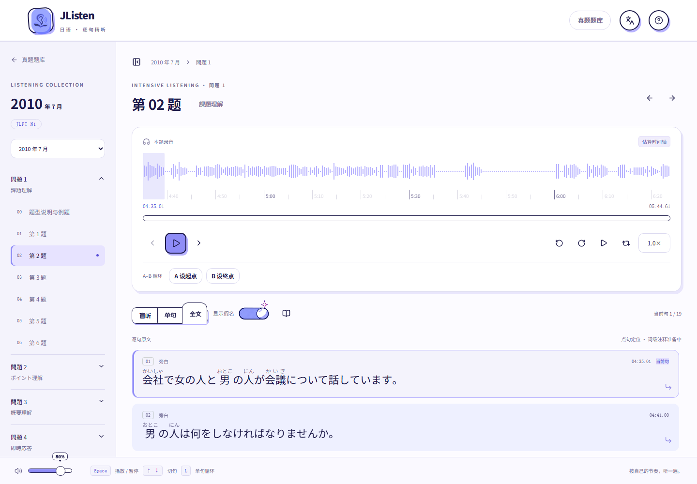
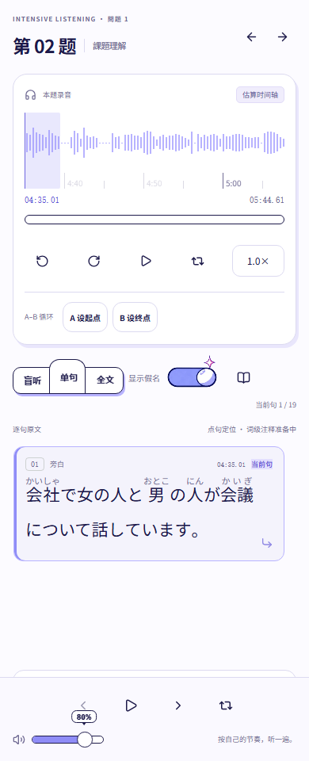
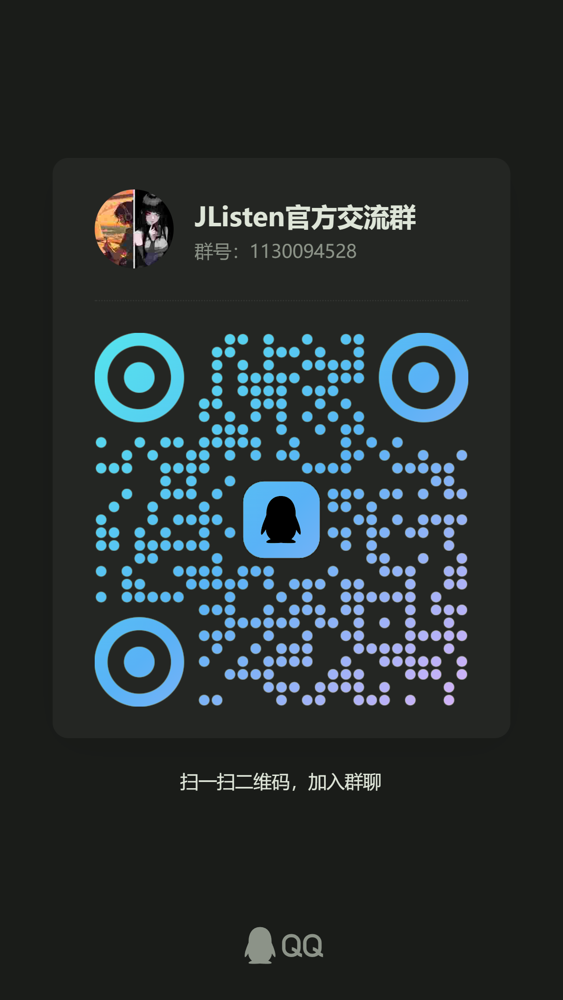

<p align="center">
  
</p>

<h1 align="center">JListen</h1>

<p align="center">JLPT N1 日语听力练习</p>

<p align="center">
  <strong><a href="https://j-listen.vercel.app/">在线使用 JListen ↗</a></strong>
</p>

<p align="center">
  <a href="#界面与演示">界面与演示</a> ·
  <a href="#功能">功能</a> ·
  <a href="#快速开始">快速开始</a> ·
  <a href="#使用方法">使用方法</a> ·
  <a href="#音频配置">音频配置</a>
</p>

## 界面与演示

### 题库

选择考试年份、月份和题型，打开题目开始练习。

<p align="center">
  
</p>

### 逐句精听

一句一句听，支持假名显示、变速播放和单句循环。

<p align="center">
  
</p>

### 词句解析

点击单词查看读音、释义和笔顺；使用解析图标切换当前句的译文、语法与考点。

<p align="center">
  
</p>

<details>
<summary>查看全文与手机界面</summary>

点击原文中的句子，跳到对应的录音位置。

<p align="center">
  
</p>

<p align="center">
  
</p>

</details>

### 操作演示

展示单句与全文切换、假名、循环与倍速提示、句子解析和词卡。

<p align="center">
  
</p>

<p align="center"><sub>约 19 秒 · 无声 · 自动循环播放</sub></p>

## 功能

JListen 用于 JLPT N1 听力练习，收录 2010–2026 年的 32 场听力资料，可以在电脑或手机上使用。

- **播放**：逐句播放、单句循环、A–B 循环和变速播放。
- **原文**：切换盲听、单句或全文，点击句子跳转到录音位置。
- **假名与听写**：显示汉字读音，点击单词查看词义、发音和笔顺，临时听写后对照原文。
- **解析**：查看当前句的中文释义、词汇、语法与考点，模型参考内容保留待复核标记。
- **界面**：支持中英文切换、键盘快捷键和减少动态效果；循环与倍速切换使用顶部提示。

## 快速开始

安装 Git、Git LFS 和 Node.js，然后运行：

```bash
git lfs install
git clone https://github.com/1716285375/JListen.git
cd JListen
npm ci
npm run dev
```

启动后打开 [http://127.0.0.1:5173](http://127.0.0.1:5173)。克隆仓库时会通过 Git LFS 下载音频；如果音频没有下载完整，在项目目录运行 `git lfs pull`，也可使用下方的网盘音频包。

## 使用方法

1. 在题库选择一场考试，打开题目或例题。
2. 用「单句」逐句练习，或在「全文」中点击想重听的句子。
3. 听不清时放慢速度或开启循环。设置 A、B 两点，可以反复播放选定的一段。
4. 点击单词查看词卡，或用解析图标查看当前句的译文与用法。需要时展开听写，切换题目或刷新后内容清空。

| 快捷键 | 操作 |
| :--- | :--- |
| `Space` | 播放 / 暂停 |
| `↑` / `↓` | 上一句 / 下一句 |
| `←` / `→` | 后退 / 前进 3 秒 |
| `L` · `[` / `]` | 单句循环 · 设置 A / B 点 |
| `?` | 查看完整使用说明 |

> 资料仍在校对，文字、假名和时间标注可能有误。尚未确定句子起止时间的内容，会定位到关联的录音片段。

## 音频配置

### 本地音频

共 33 个 MP3，约 1.16 GB，未重新编码。

不使用 Git LFS 时，可从 [Google Drive 下载音频包](https://drive.google.com/file/d/1ZPX5TtASaxfJAssbiA08CWX-BrwbsGMZ/view?usp=drive_link)（约 927 MB）。

解压后按考试场次放入 `public/audio/n1/`，例如：

```text
public/audio/n1/2010-07/jlpt-n1-2010-07-listening.mp3
```

其他场次按相同规则命名。2025 年 7 月另有两个版本：`jlpt-n1-2025-07-listening-live.mp3`（现场版）和 `jlpt-n1-2025-07-listening-ai.mp3`（AI 发音版）。

### 外部音频

如果音频放在外部服务器，将 `.env.example` 复制为 `.env.local`，填入服务器地址：

```dotenv
VITE_AUDIO_BASE_URL=https://audio.example.com
```

服务器上的目录应与本地一致，例如 `https://audio.example.com/audio/n1/2010-07/jlpt-n1-2010-07-listening.mp3`。服务器须支持 HTTPS 和 Range 请求，才能跳转到指定位置播放。

留空则使用本地音频。配置外部地址后，打包时会排除本地音频。应用是纯前端项目，无需后端。

## 联系方式

QQ：**1716285375** · QQ 群：**1130094528**

有使用问题或发现文稿错误，可以通过 QQ 联系，也可以加入交流群。

<p align="center">
  
</p>
