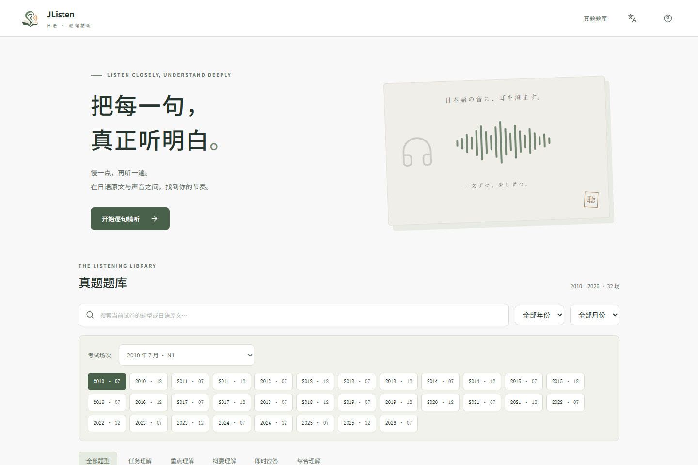
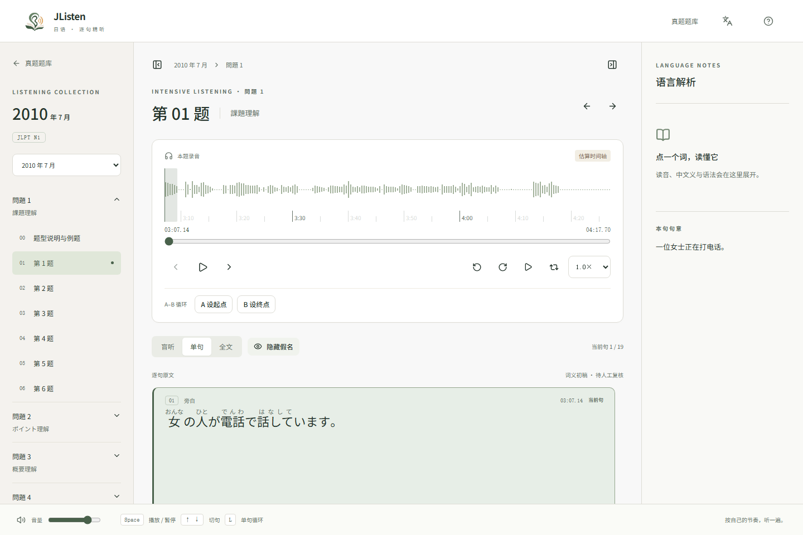
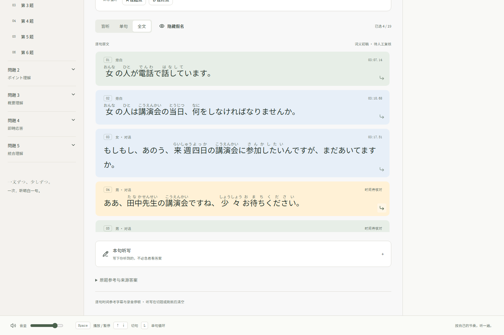
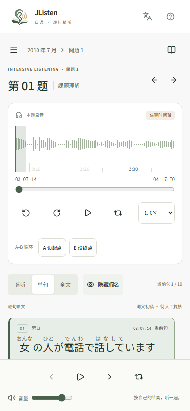
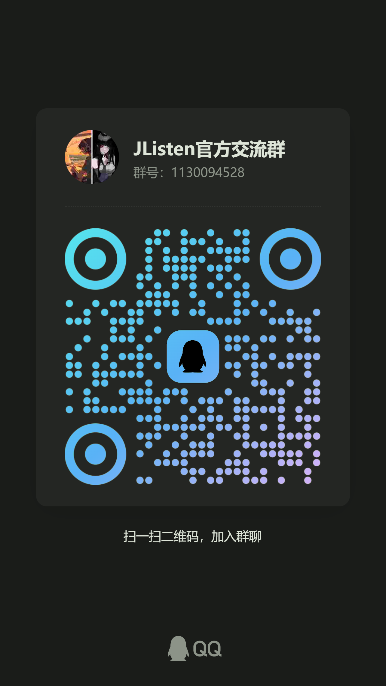

<p align="center">
  
</p>

<h1 align="center">JListen</h1>

<p align="center">日语 JLPT N1 听力练习 · 听清每一句</p>

<p align="center">
  <a href="#界面与演示">界面与演示</a> ·
  <a href="#功能">功能</a> ·
  <a href="#快速开始">快速开始</a> ·
  <a href="#使用方法">使用方法</a> ·
  <a href="#音频配置">音频配置</a>
</p>

## 界面与演示

### 题库

按年份、月份和题型选择练习内容。

<p align="center">
  
</p>

### 逐句精听

查看假名、调整速度，反复听清当前句。

<p align="center">
  
</p>

<details>
<summary>查看全文与手机界面</summary>

点击全文中的句子，定位到关联录音。

<p align="center">
  
</p>

<p align="center">
  
</p>

</details>

### 操作演示

选题 → 单句播放 → 切句与循环 → 全文定位 → 中英文切换。

<p align="center">
  
</p>

<p align="center"><sub>约 26 秒 · 无声 · 自动循环播放</sub></p>

## 功能

JListen 是一个纯前端听力练习应用，收录 2010–2026 年的 32 场 N1 听力资料，支持电脑和手机使用。

- **逐句精听**：点击原文定位录音，支持单句播放、循环和 A–B 循环。
- **灵活练习**：切换盲听、单句或全文模式，按需要调整播放速度。
- **辅助阅读**：显示汉字假名，查看已标注的词义，使用听写对照检查理解。
- **中英文界面**：右上角切换语言，常用操作支持键盘快捷键。

## 快速开始

准备 Node.js 和 npm，在项目目录运行：

```bash
git lfs install
git clone https://github.com/1716285375/JListen.git
cd JListen
npm ci
npm run dev
```

打开 [http://127.0.0.1:5173](http://127.0.0.1:5173)。音频通过 Git LFS 保存，克隆时会一并下载；已有代码但缺少音频时，在项目目录运行 `git lfs pull`。

## 使用方法

1. 在题库选择考试场次，再从目录打开题目或例题。
2. 选择「单句」逐句练习，或选择「全文」点击需要重听的句子。
3. 听不清时放慢速度，开启单句循环；需要自选范围时设置 A、B 两点。
4. 按需要显示假名或展开听写。听写内容在切题或刷新后清空。

| 快捷键 | 操作 |
| :--- | :--- |
| `Space` | 播放 / 暂停 |
| `↑` / `↓` | 上一句 / 下一句 |
| `←` / `→` | 后退 / 前进 3 秒 |
| `L` · `[` / `]` | 单句循环 · 设置 A / B 点 |
| `?` | 查看完整使用说明 |

> 部分句子尚未确认独立的起止时间，点击时会定位到关联录音片段。文字、假名与时间标注仍可能有误。

## 音频配置

### 本地音频

仓库包含 33 个原始 MP3，约 1.16 GB，通过 Git LFS 下载。音频没有重新编码，保留原始质量。

也可以从 [Google Drive 下载完整音频包](https://drive.google.com/file/d/1ZPX5TtASaxfJAssbiA08CWX-BrwbsGMZ/view?usp=drive_link)（约 927 MB），按下方目录放入项目。

按场次放入 `public/audio/n1/`，例如：

```text
public/audio/n1/2010-07/jlpt-n1-2010-07-listening.mp3
```

其他场次使用相同命名规则。2025 年 7 月分别使用 `jlpt-n1-2025-07-listening-live.mp3`（现场版）与 `jlpt-n1-2025-07-listening-ai.mp3`（AI 发音版）。

### 外部音频

将 `.env.example` 复制为 `.env.local`，填写音频服务的公开地址：

```dotenv
VITE_AUDIO_BASE_URL=https://audio.example.com
```

服务端保留 `audio/n1/年月/文件名.mp3` 的目录结构，并支持 HTTPS 与 Range 请求，以便跳转播放。例如上述音频的地址为 `https://audio.example.com/audio/n1/2010-07/jlpt-n1-2010-07-listening.mp3`。

留空时读取本地音频；配置外部地址后，构建产物不包含本地音频文件。应用无需后端。

### Vercel 部署

导入 `1716285375/JListen`，选择 Vite 框架，输出目录使用 `dist`。在项目的 **Settings → Git** 中开启 **Git LFS** 后重新部署，才能读取完整音频。使用仓库音频时，`VITE_AUDIO_BASE_URL` 留空。

当前资料仍在校对。`npm run build` 执行严格发布校验，未复核的内容会阻止构建；预览当前版本可将 Vercel 的 Build Command 改为 `npm run build:dev`，该命令仍检查数据结构和 TypeScript，但不表示逐句校对已完成。

## 开发者与交流

开发者 QQ：**1716285375** · JListen 交流群：**1130094528**

使用问题、建议和内容纠错，欢迎通过 QQ 联系或加入交流群。

<p align="center">
  
</p>
